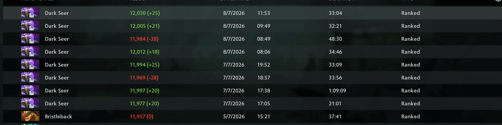

# Show MMR for Minify

A [Minify](https://github.com/Egezenn/dota2-minify) port of AveYo's
[ShowMMR](https://github.com/AveYo/ShowMMR) Dota 2 mod. It records your ranked
MMR after every match and shows `MMR (change)` next to each ranked game in your
match history, and the change on the last-match badge.



Development build: normal ranked captures and restart persistence work live;
early-leave recovery and exact match identity are still open
([open questions](docs/open-questions.md)).

## Requirements

- Dota 2 with Dota 2 Workshop Tools (Minify compiles Panorama JS/XML with them)
- Minify 1.14rc6 (the version this build is tested with)

## Install

1. Copy `Minify/mods/Show MMR` into your Minify `mods` folder.
2. Close Dota, open Minify, enable **Show MMR** and click **Patch**.
3. Start Dota with Minify's launch options.

When upgrading, replace the whole `Show MMR` folder.

## Use

Play ranked as usual. After each match, while you are idle on the dashboard, the
mod briefly opens your match history, reads the new MMR and saves the result.
The first visit on an account only saves a starting point (baseline); results
are recorded from the next ranked match on.

**Settings > Show MMR** shows the account, baseline, what recording is doing,
saved matches, the last result and the net change over the last 24 hours. It has:

- **Refresh from history**: check for a new result now.
- **Start new baseline**: only enabled when a conflict or an MMR change without a
  match has paused recording; clears that pause and keeps your history.
- **Show MMR in match results** and **Record results automatically**, saved per account.

The settings page follows Minify's output language: English, Russian, Simplified
Chinese, Spanish and Brazilian Portuguese.

History is kept per account (newest 100 matches) in Dota's controller slot 3
key bindings:

```text
C:\Program Files (x86)\Steam\userdata\<account_id>\570\local\cfg\user_keys_0_slot3.vcfg
```

## Troubleshooting

- **Nothing shows:** check Show MMR is enabled in Minify and patch again. Rows
  without a saved result keep Dota's normal Win/Loss text.
- **Recording paused:** use **Start new baseline** in Settings.
- **Logs:** search Dota's `console.log` (launch with `-condebug`) for `[ShowMMR]`.
- Missed games, recalibration or a crash can leave gaps; the mod never invents a
  missing result.
- `tools/clear_show_mmr_data.ps1` removes the mod's saved data (with a backup;
  supports `-WhatIf`). It is never needed for install or upgrade.

## More

- [How it works](docs/how-it-works.md): capture rules, storage format, manual test data
- [Development](docs/development.md): tests, logs, Dota+ probe
- [Storage ideas](docs/storage-ideas.md): unimplemented designs for larger storage

## Repository layout

```text
Minify/mods/Show MMR/   the mod, exactly as Minify installs it
tests/                  regression tests (no Dota needed)
tools/                  data cleanup and optional development log collector
docs/                   documentation
```

## License

MIT, see `LICENSE`. Original project: https://github.com/AveYo/ShowMMR
